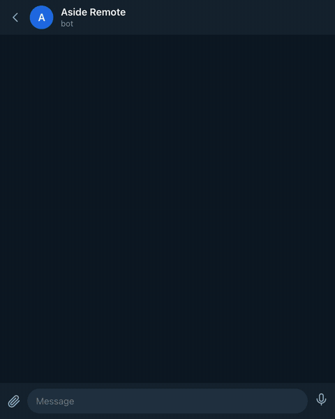

# Aside Remote Control

Remote-control your [Aside](https://aside.com) browser agent from chat apps. Send a message, the agent runs it as a full task in your local browser, and replies in the chat. **Telegram** is built in; other platforms plug in as channel modules.

<p align="center">
  
</p>

- Zero runtime dependencies (Node 18+ standard library only). No webhook, no public URL, no hosted backend: pure long-polling.
- Real sessions: each chat is one Aside session, so follow-ups ("the second one") just work. `/new` starts over.
- Live, clean replies: the message updates as the agent works and ends as just the answer, with Markdown rendered.
- Control from chat: `/stop`, steer a running task with a correction, queue more work or run it alongside with `/btw`.
- Voice and files: speak the task or send photos and PDFs. Image files the agent mentions come back as photos, and replies can be spoken (optional, ElevenLabs).
- Groups and forum topics, with per-user access control so only you can drive your browser.

> The bridge drives **your** local Aside agent. Anyone you authorize can make it do anything you can. Treat the bot token and your config like credentials.

## How it works

```
Telegram  ──getUpdates──▶  aside-remote bridge  ──spawn──▶  aside CLI  ──▶  your browser
   ▲                              │
   └────────── sendMessage ◀──────┘  (agent output, screenshots)
```

The first message in a chat starts an Aside session, and every later message resumes it (`aside session resume <id> <message>`), so Aside itself carries the conversation. Each chat, and each forum topic, runs one task at a time, in order.

## Setup

You need:

1. **Node 18+**
2. **The Aside CLI**, installed and signed in:
   ```bash
   curl -fsSL https://releases.aside.com/install.sh | bash
   aside "hello"   # confirm it runs a session
   ```
3. **macOS: python3** (`xcode-select --install`). The CLI only prints to a terminal, so the bridge runs it in a small python3 pseudo-terminal. Linux runs it directly.
4. **A Telegram bot token**: message [@BotFather](https://t.me/BotFather), send `/newbot`, and copy the token (`123456789:AAH...`).

Then:

```bash
git clone https://github.com/atmirrr/aside-remote-control.git
cd aside-remote-control
npm link                             # or: npm install -g .
aside-remote channels add telegram   # paste the token; your chat id is detected
aside-remote start                   # long-running; Ctrl-C to stop
```

(Or skip the install and run `node bin/aside-remote.js <command>`.) Now message your bot, e.g. `open my Gmail and tell me the latest unread subject`, and the agent does it and replies. Send `/help` in the chat for commands.

## Permissions

Bridge tasks run with your Aside default permission. With **full access** the agent can read and write files anywhere, which remote use usually needs. With **Guard**, Aside asks before the agent touches a folder outside its allowed list, and a task driven from chat can sit on that question until you tap Stop. Either run bridge tasks with full access:

```json
{ "agent": { "newArgs": ["--permission", "full-access"] } }
```

or stay on Guard and set `attachments.dir` to a folder Aside already allows, so the agent can open the files you send.

## Using it from chat

| Message | Effect |
| --- | --- |
| `/help` | Show help (`/start` does the same) |
| `/new` | Start a fresh agent session (drop context) |
| `/stop` | Stop everything running in this chat and drop anything queued |
| `/steer <text>` | Send a correction into the running task right now |
| `/btw <task>` | Run a task now instead of queueing (in its own session if something is already running) |
| `/voice` | Toggle voice replies on/off |
| `/status` | Show the session id and what is running or queued |
| `/whoami` | Show your chat id (handy when authorizing) |
| a voice note | Transcribed, then run as a task |
| a file or photo | Downloaded, then handed to the agent |
| anything else | Run as a task in the browser |

A message sent while a task runs waits under a **Queued** notice. Tap **send now** to push it into the running task instead, like `/steer`: the task keeps its progress and the answer continues below your correction.

Nothing is killed automatically. If a task runs past 30 minutes, or prints nothing for 7, the chat gets "This is taking longer than usual" with a **Stop** button. Stop ends that task, `/stop` ends everything in the chat, and both stop the Aside session too, so the browser doesn't carry on.

## Task cards (Telegram widgets)

With `"cards": true` on the Telegram channel, each task in a private chat shows as the live card in the GIF above (a Bot API 10.4 widget) instead of a "Thinking..." bubble:

- the agent's steps, newest at the bottom
- up to four helper agents (subagents) the task started, each with a small bot that shows done, failed or stopped when it ends
- elapsed time, and `quiet 2m` once no new step has come for a minute
- Stop, which acts after five seconds unless you tap Undo
- a small widget under each message you send mid-task: Send now steers it in
- the answer, below the card as its own message (the only notification)

Groups and forum topics keep the text bubble, since Telegram shows widgets only in private chats. Helper agents are read from Aside's `state.db` with `sqlite3`; set `agent.stateDb` if your Aside account isn't `~/.aside/u/0`. The card is `src/channels/telegram-card.html` and must stay under Telegram's 4096 bytes after zlib.

## Groups and forum topics

- **Allow the group:** add the bot and send `/whoami@YourBot` there. Put the chat id it replies with in the channel's `allowedChatIds` in `config.json`, then restart the bridge.
- **Choose who can drive it:** set `allowedUserIds` on the channel. Everyone else is ignored, button taps included. Your user id is what `/whoami` shows in a private chat with the bot.
- **Forum topics** each get their own session, queue and `/stop`.
- **Privacy mode:** by default a bot in a group only sees commands and replies to its own messages. Turn it off in @BotFather (`/setprivacy`, then Disable) or make the bot an admin.

## Voice notes and attachments

**Voice** needs a speech-to-text endpoint. Any OpenAI-compatible `/audio/transcriptions` API works; the simplest setup is:

```bash
export OPENAI_API_KEY=sk-...
aside-remote start
```

The bot echoes what it heard (`🎙️ open my email`) before acting, and deletes the recording as soon as it's transcribed. Without an endpoint, voice notes get a setup hint and everything else keeps working.

To keep audio on your machine, run a local whisper server, such as [speaches](https://github.com/speaches-ai/speaches) or `whisper-server` from [whisper.cpp](https://github.com/ggerganov/whisper.cpp), and point `baseUrl` at it. A loopback URL needs no API key (plain `http://` is allowed for loopback only):

```json
{ "voice": { "baseUrl": "http://127.0.0.1:8000/v1", "model": "small.en" } }
```

**Attachments** (photos, documents, video) are saved to `~/.aside-remote/attachments/<channel>/<chat>/` and their paths added to the prompt, so the agent opens them with its own file tools (see [Permissions](#permissions)). Audio files and round video notes are transcribed like voice notes. An album is one task, a caption is never read as a command, and Telegram caps bot downloads at 20 MB.

## CLI commands

| Command | What it does |
| --- | --- |
| `aside-remote channels add [type]` | Add a channel (interactive wizard) |
| `aside-remote channels list` | List configured channels |
| `aside-remote channels remove <id>` | Remove a channel |
| `aside-remote channels test [id]` | Send a test message through a channel |
| `aside-remote start [--channel <id>]` | Start the bridge |
| `aside-remote help` / `version` | Help / version |

## Configuration

State lives in `~/.aside-remote/` (override with `ASIDE_REMOTE_HOME`): `config.json` (channels with their bot tokens, plus the settings below), `sessions.json` (chat to session id), `history.json` (recent turns), `cards.json`, `origins.json` (which channel started each session) and `attachments/`.

Every setting is optional. Full defaults are in [`src/config.js`](src/config.js).

**`agent`**

- `command`, `newArgs`, `continueArgs`, `sessionRegex`: how the CLI is called. A new chat runs `aside <newArgs> <message>` and the session id is read from its output; later messages resume that session. A rejected id is dropped and the message retried as a new session. `sessionRegex: null` makes every message a new session.
- `wrapper`: the macOS pseudo-terminal. `[]` runs the CLI directly.
- `stopSessionOnAbort` (`true`): Stop also runs `aside session stop <id>`, so a browser step in flight doesn't carry on.
- `timeoutMs` (30 min), `idleTimeoutMs` (7 min with no output, `0` = off): when the chat offers a Stop button. The task keeps running unless `killOnTimeout` is `true`, which suits an unattended bridge.
- `autoApprove` (`true`): accepts every approval prompt Aside shows on its terminal, so remote tasks don't hang (see [Security](#security)). Tune `approvePromptRegex` and `approveInput` if your Aside build words its prompt differently.
- `stream` (`true`), `streamThrottleMs` (1800): edit the reply in place as the agent works.
- `verbose` (`false`): forward the full raw transcript instead of just the answer.
- `context` (`true`), `contextMaxChars` (20000): when a chat with history has to start a new session (a `/btw` task, a rejected id), prepend its recent turns.
- `summary` (`false`): ask the agent to end with a short recap after a marker line, and show only that (`summaryMarker`, `summaryPrompt`). If it skips the marker, the full answer shows as usual.
- `voice` (`false`), `voiceApiKey`, `voiceId`, `voiceModelId`: replies as [ElevenLabs](https://elevenlabs.io) voice notes (implies `summary`, falls back to text). Put the key in `ELEVENLABS_API_KEY`. `/voice` toggles it and the choice is saved.

**`voice`** (speech to text)

- `baseUrl` (`https://api.openai.com/v1`), `model` (`whisper-1`): any OpenAI-compatible endpoint, e.g. Groq (`https://api.groq.com/openai/v1`), OpenRouter, or a local whisper server.
- `apiKey`, `apiKeyEnv` (`OPENAI_API_KEY`): `apiKey` wins if set. Prefer the env var, since it never touches disk.
- `language` (`null` = auto-detect, or a hint like `"en"`), `prompt` (optional spelling hints for names and jargon; OpenRouter ignores it, so there the words in `~/.aside-remote/vocabulary.txt` are passed to Groq instead).
- `echoTranscript` (`true`): post what was heard before acting. Leave it on: it's how you catch a mishearing.
- `enabled` (`true`): `false` refuses voice notes before anything is downloaded.

**`attachments`**

- `enabled` (`true`): `false` refuses files before anything is downloaded.
- `dir` (`null` = `~/.aside-remote/attachments`), `maxBytes` (20 MB).

## Troubleshooting

- **The bot ignores everything.** Telegram hands each update to one poller, so a second bridge on the same token steals your messages. Run only one; the log says `another process is polling this bot token`. Right after a restart this can show briefly while Telegram closes the old poll (up to 30 s).
- **The bot ignores plain messages in a group.** That's Telegram's privacy mode; see [Groups and forum topics](#groups-and-forum-topics).
- **A task goes quiet, then "This is taking longer than usual".** Either a slow page, or the agent is waiting on something nobody can answer from chat, most often a Guard permission question (see [Permissions](#permissions)). Tap Stop if it's stuck.

## Security

- Always set `allowedChatIds` (the wizard does it). With it empty, the bot is **open** and anyone who finds it can control your browser.
- Other chats get "not authorized" with their chat id, so you can choose to allow them. In a group, `allowedUserIds` limits who can drive the agent.
- Files are **never downloaded until the sender is authorized**. They land in `~/.aside-remote/attachments/` (`0700`/`0600`); delete it whenever you like.
- Voice recordings are deleted right after transcription (only the text is kept, in `history.json`), but the audio goes to `voice.baseUrl` (OpenAI by default). Use a local whisper server to avoid that.
- Any local image path (`.png`, `.jpg`, `.webp`, `.gif`) in the agent's output is uploaded to the chat.
- `autoApprove` is **on by default**, so an authorized chat can approve anything Aside asks. Set `autoApprove: false` if you'd rather a prompted task wait.
- Tokens live in `config.json`. Keep `~/.aside-remote/` private (the CLI creates it `0700`/`0600`); the repo's `.gitignore` already excludes config.

## Adding a channel

A channel is a class extending `Channel` (`src/channels/base.js`). It needs `static type`, `static async setup(io)` (the `channels add` wizard), `start({ onMessage, onAction, control, signal })` and `sendText(chatId, text, opts)` returning the sent message's id. Optional: `editText` (live streaming), `deleteMessage`, `sendTyping`, `sendImage` / `sendImages`, `sendVoice`, and inline buttons (render `opts.buttons`, report taps through `onAction`). Voice-style channels can override `wantsPlaceholder`, `forcesSummary` and `summaryPrompt`, and use `control` for stop, status, reset and steer.

Ship it built in (`src/channels/<platform>.js`, registered in `src/channels/index.js`) or as its own module: point a channel's `module` field (an absolute or `~/` path, a path relative to `ASIDE_REMOTE_HOME`, or a package name) at a file that exports the class.

```json
{ "channels": [{ "id": "my-channel", "type": "my-platform", "module": "~/my-channel/index.js" }] }
```

If a module fails to load, the bridge logs why and starts the other channels. For voice and files, include an `attachments` array on each message (shape in `base.js`) and keep `download()` **lazy**: the bridge calls it only after authorization.

## Roadmap

- In-chat approve/deny buttons instead of `autoApprove` accepting everything.
- Per-chat and global caps on spawned agent processes.
- More channels: Slack, Discord, iMessage, WhatsApp.
- Send generated documents back as files (only images today).
- Per-message model, speed and effort (`/model`, `/fast`, `/effort`).

## License

MIT, see [LICENSE](./LICENSE).
